# ICH ABMIL + VisionHOPE

Weakly supervised, multi-label intracranial hemorrhage classification (EDH, SDH, tSAH, IVH, Contusion)
from axial brain CT NIfTI scans with scan-level labels only. Each scan is a bag of 2D axial slices; a
VisionHOPE slice encoder (self-referential nested learning, SRNL) feeds per-class gated attention MIL
(Ilse et al., 2018).

**Research code. Nothing here is clinically validated.** The dataset is private and not included; the
repository contains code and aggregate results only.

## Layout

```
configs/default.yaml      all hyperparameters, paths, seed
data/manifest.py          Excel labels -> pre-surgery cohort -> NIfTI join -> outputs/scan_manifest.csv
data/splits.py            patient-level iterative stratification (70/15/15) + 5 folds -> outputs/splits.csv
data/dataset.py           bag datasets (slices / cached features), padding collate, GPU augmentation, sampler
preprocess.py             orientation, intracranial mask, 3 windows, edge trim, uint8 cache, orientation CNN, plots
models/encoder.py         Encoder interface: VisionHOPEEncoder, TimmEncoder (ConvNeXt-T)
models/abmil.py           per-class / shared gated attention MIL, optional SRNL slice context, BagModel
models/baselines.py       mean / max pooling heads, sklearn baselines for Phase 0
models/losses.py          ASL, focal (+pos_weight), BCE
phase0.py                 QC montages, orientation/laterality checks, cheap baselines, 30-scan overfit
train.py                  feature cache, Stage A (head on cached features), Stage B (end-to-end)
eval.py                   metrics + patient-clustered CIs, thresholds, stratified reports, probes, galleries,
                          Grad-CAM, ablation table
utils/viz.py              all plots (matplotlib Agg, optional TensorBoard writer)
scripts/                  smoke tests, leakage audit, operating points, debugging helpers,
                          trim_qc.py (kept/dropped slice montages), *_wsl.sh (WSL2 pipeline runners)
e2e_vh/, e2e_vh_ft/       checkpoints + reports: first Stage B run, and its continuation on re-trimmed bags
e2e_vh_mt/, cistern_vh/   multi-task model (Marshall components) and basal-cistern model + Marshall reports
vh_small_final/           final model: VisionHOPE-small, all outputs, both slice groups; calibration.json
predict_scan.py           NIfTI in -> JSON report (hemorrhage, midline shift, cisterns, volume, Marshall) + Grad-CAM
docs/article/             research article (index.html + fig/, and a self-contained bundle)
lesion_volume.py          hyperdense lesion volume from HU without segmentation labels (prototype)
```

## Environment

- Tested on an RTX 5080 (Blackwell, sm_120, 16 GB). VisionHOPE pins PyTorch 2.1 / CUDA 12.1, which has no
  sm_120 support, so it runs on PyTorch 2.10 + cu128. Its CUDA extensions are JIT-compiled with a CUDA 12.8
  `nvcc` (conda-forge, e.g. `micromamba create -p ~/cuda128 cuda-version=12.8 cuda-nvcc cuda-cudart-dev
  libcublas-dev libcusparse-dev libcusolver-dev cuda-nvrtc-dev cuda-profiler-api libcurand-dev cuda-nvtx-dev`;
  headers symlinked into `include/`, `lib64 -> lib`). `env.sh` sets `CUDA_HOME`, `TORCH_CUDA_ARCH_LIST=12.0`.
- `scripts/smoke_visionhope.py` checks forward/backward under bf16 autocast with FP32 parameters.
  `fast_inference` / `prepare_for_inference` are never used during training.
- `e2e_vh_ft` was trained on Windows + WSL2 (Ubuntu 24.04) with an RTX 3070 (8 GB): micromamba env with
  Python 3.11, conda-forge CUDA 12.4 `nvcc` (the SRNL kernels have no PyTorch fallback and need a JIT build),
  PyTorch 2.5.1 (PyPI cu124 wheel). `env_wsl.sh` sets `CUDA_HOME`, `TORCH_CUDA_ARCH_LIST=8.6`;
  `scripts/wsl_run.sh <log> <cmd>` runs a command under it. With gradient checkpointing a 60-slice group needs
  2.4 GiB at the same speed as without, so the original batching fits in 8 GB (~43 min/epoch). The WSL virtual
  disk lives on C:, so `configs/default.yaml` puts NIfTI and outputs on D:.

```bash
python -m venv --system-site-packages .venv && source .venv/bin/activate
pip install -r requirements.txt
git clone https://github.com/PSRben/VisionHOPE third_party/VisionHOPE && pip install --no-deps -e third_party/VisionHOPE
# weights/visionhope_tiny.pth from the VisionHOPE GitHub release (weights-v1)
```

Expected data layout (set in `configs/default.yaml`): NIfTI files `<accession>_<ctindex>.nii.gz` in
subfolders `1..11` of `paths.nifti_root`, plus the CT-level and patient-level Excel files.

## Commands

```bash
source env.sh
python -m data.manifest                          # Phase 0: manifest, cohort rule, join checks
python preprocess.py --stage cache               # Phase 1: masks, windows, edge trim, cache (~30 min, 24 workers)
python preprocess.py --stage orient              # anterior-direction CNN, fixes rotations
python scripts/leakage_audit.py                  # writes exact_duplicates.csv (used by the exclusion list)
python scripts/make_exclusions.py
python preprocess.py --stage plots
python -m data.splits                            # Phase 2: patient-level splits
python train.py --stage features                 # VisionHOPE features: clean + 2 augmented train views
python train.py --stage features --set encoder.name=convnext_tiny
python phase0.py --step qc
python phase0.py --step baselines
python phase0.py --step overfit                  # gate: train AUC > 0.97 on 30 scans
python train.py --stage A --run abmil_vh
python train.py --stage B --run e2e_vh --init outputs/runs/abmil_vh/best.pt
python eval.py --run e2e_vh                                          # F1-optimal thresholds from val
python eval.py --run e2e_vh --threshold-mode recall --target-recall 0.8
python train.py --stage A --run abl_mean --set model.pooling=mean   # ablations, see below
python eval.py --ablation abmil_vh abl_mean abl_max abl_shared abl_srnl abl_bce abl_focal abl_convnext e2e_vh
python -m tensorboard.main --logdir outputs/tb
```

Re-trimmed bags + continued fine-tuning (`e2e_vh_ft`, WSL2):

```bash
python scripts/trim_qc.py --n 40                 # kept/dropped montages for the anatomic trim
bash scripts/rebuild_data_wsl.sh                 # cache (trim_mode: anatomic) -> orient -> splits --from-preds e2e_vh
bash scripts/finetune_wsl.sh                     # baseline eval, Stage B from e2e_vh/best.pt (encoder + head), eval
bash scripts/export_ft_docs_wsl.sh               # de-identified galleries + plots -> docs/figures
bash scripts/finetune_mt_wsl.sh                  # multi-task model e2e_vh_mt (needs python -m data.manifest rerun)
bash scripts/eval_mt_wsl.sh                      # 5-class report + task heads + Marshall rule
python scripts/marshall_stack.py --run e2e_vh_mt # learned Marshall combiner (fit on val, tested once)
bash scripts/cistern_pipeline_wsl.sh             # lesion volumes val/test + cistern cache + cistern_vh model + eval
python scripts/marshall_final.py --mt e2e_vh_mt --cistern cistern_vh   # Marshall from all three sources
python lesion_volume.py --stage run --split val --limit 200 && python lesion_volume.py --stage eval --split val --limit 200
```

Long WSL runs are launched with `Start-Process wsl.exe ... -WindowStyle Hidden` from PowerShell, so they do not
depend on the launching terminal.

`python -m data.splits --from-preds e2e_vh` reuses the exact train/val/test assignment stored in the earlier
run's prediction files, so continued training never sees its val/test patients. `train.py --init` loads the
whole `BagModel` when given a Stage B checkpoint (head only for Stage A).

## Data decisions and assumptions

- Labels: CT-level file (one row per CT). Classes `EDH, SDH, tSAH, Has_IVH, Contusion`; `Has_Any ICH` is
  an auxiliary target (0 mismatches with any-of-5). Scan ID = `(accession, CT index)`.
- Pre-surgery cohort rule as specified (CTs up to and including the first post-surgery flag are removed
  from that point on), plus free-text exclusion of burr-hole / catheter / cranioplasty rows. The patient
  file is used only for Age/Sex and a surgery cross-check. Clinical outcome data and radiologist findings
  (midline shift, Marshall score, ...) are never model inputs.
- The shortest array axis is the axial stack (some affines mislabel it). Two 4D files: first volume used.
- Orientation: canonical reorientation from the affine where consistent, then a 4-way anterior-direction
  CNN trained on rotated affine-consistent scans checks every scan and fixes rotations (thumbnails at 25/50/75 %
  of the bag; 5/30/60 % with the anatomic trim, which removes the asymmetric skull base the CNN relied on, run
  twice so the second pass trains on the corrected cache; 41 of the 9,431 cohort scans stay below 0.9
  confidence and keep their affine orientation). Left/right cannot be
  inferred from anatomy; it is taken from the affine and verified against laterality labels (radiological
  convention: patient right on image left). No flip augmentation.
- Intracranial mask per slice: interior of the closed skull ring (bone > 300 HU, closed with a 3 mm disk);
  slices without a closed ring use the nearest ring slice's interior. Candidate tissue -20..140 HU, erosion
  and component filtering, then a generous 6 mm dilation so SDH/EDH against the inner table survive.
- Slice selection: slices outside the main run of skull-ring slices (+-2) are dropped (neck/face, where
  muscle mimics blood), as are slices with < 15 cm2 intracranial area. Then the ends of the stack are trimmed
  (interior slices are never removed):
  - `e2e_vh` (`trim_mode: area`): end slices whose soft-tissue area is < 25 % (skull base) or < 12 % (vertex)
    of the scan's largest slice. Median bag 21 slices. This kept petrous / posterior-fossa, orbit and tiny vertex
    slices, and the attention + Grad-CAM galleries of `e2e_vh` often picked exactly those.
  - `e2e_vh_ft` (`trim_mode: anatomic`, default): from the HU volume, before cropping. Base end: drop while the
    intracranial area is < 45 % of the scan max **or** bone inside the convex hull of the intracranial mask
    (petrous ridges, clivus, sphenoid, orbital roofs; ~0 on supratentorial slices, robust to head holders) is
    > 2 % of the max intracranial area. Vertex end: drop while area < 25 % of max. At least 8 slices kept and at
    most 40 % of a bag dropped. Removes on average 3.5 base + 1.5 vertex slices; median bag 17 (range 3-36).
    Sella / suprasellar-cistern levels score ~1 % bone and are kept (basal-cistern tSAH).
- Windows (each in [0,1]): brain L40/W80, subdural L80/W200, stroke L40/W40. Square crop around the
  intracranial region, resized to 256, stored uint8; the encoder sees 224.
- Excluded (49 scans): orientation-uncertain, manually identified sagittal/coronal reformats, and 32
  byte-identical files stored under two CT indices of the same patient (4 of those pairs had conflicting
  labels). Final cohort: 9,431 scans from 3,598 patients.
- Splits by patient only: train 6,608 scans / 2,518 patients, val 1,406 / 540, test 1,417 / 540.

## Training

- Stage A: ABMIL head on cached frozen VisionHOPE features (clean view + 2 augmented train views), ASL loss,
  class-balanced sampler (50 % class-balanced / 50 % uniform), AdamW, cosine schedule, EMA, early stopping
  on val macro AUPRC.
- Stage B: end-to-end from the Stage A head; encoder LR 1e-5, head LR 1e-4, bf16 autocast, frozen BatchNorm,
  augmentation (rotation, scale, translation, contrast, brightness, noise; no flips), 4 bags per step packed
  into <= 60-slice groups, effective batch 16, gradient checkpointing off (13.5 GB peak), 12 epochs.
  SRNL parameters (including the learned initial memories of every block) are updated.
- Continued Stage B (`e2e_vh_ft`): encoder + head initialized from `e2e_vh/best.pt`, re-trimmed bags, same
  splits, same batching (4 bags x 4 accumulation, <= 60-slice groups, gradient checkpointing on), encoder LR 5e-6,
  head LR 3e-5, 0.5 warmup epochs, 8 epochs, patience 3. All trainable tensors moved (relative change vs
  `e2e_vh` at epoch 4: SRNL memories 0.03 %, rest of the encoder 0.1 %, head 0.9 %; BatchNorm stays frozen).
- Logged each epoch: loss, macro/per-class AUROC and AUPRC, accuracy / balanced accuracy / recall /
  precision / specificity at 0.5, attention entropy and peak, gradient norm, LR, attention snapshots.

## Results (measured)

### Phase 0

| Check | Result |
|---|---|
| Manifest join | 12,155 label rows, 0 duplicate keys, every label row has a file; positives match the spec |
| Laterality (SDH, radiological convention) | 70-75 % on the expected side, p ~ 1e-62 |
| Frozen ConvNeXt-T mean-pool + logistic regression | val macro AUROC 0.764 |
| Frozen VisionHOPE mean-pool + logistic regression | val macro AUROC 0.739 |
| HU-statistics GBM / logistic regression | val macro AUROC 0.699 / 0.702 |
| Overfit 30 scans, head on frozen features | train AUC 1.00 |
| Overfit 30 scans, end-to-end (encoder LR 1e-5) | train AUC 0.97 at epoch 11, 1.00 at epoch 17 |

Encoder LR 1e-4 collapsed the pretrained features (uniform attention, train AUC 0.57); 1e-5 is used.

### Leakage audit (`scripts/leakage_audit.py`)

| Check | Result |
|---|---|
| Patients in more than one split | 0 |
| Exact duplicate files across splits / patients | 0 / 0 (32 within-patient duplicates excluded) |
| Near-duplicates (val/test vs train, feature similarity vs other-patient null) | 15 above the null 99.5th percentile (14 expected by chance), none >= 0.99 |
| Shuffled-label control | val macro AUROC 0.491 (real labels 0.739) |
| Scan metadata alone (slices, thickness, spacing, size, CT index) | 0.50-0.61 per feature |

The storage subfolder correlates with labels because folders group patients by number of CTs (sicker
patients get more follow-ups); it is not a model input and every split has the same folder mix.

### Re-trimmed bags + continued fine-tuning (`e2e_vh_ft`), held-out test set

Same test patients as below; F1 thresholds chosen on val. 95 % patient-clustered bootstrap CIs.

| | Macro AUROC | Macro AUPRC | Bal. acc. | EDH AUPRC | SDH AUPRC | tSAH AUPRC | IVH AUPRC | Contusion AUPRC |
|---|---|---|---|---|---|---|---|---|
| `e2e_vh`, original bags (reference) | 0.844 [0.82, 0.86] | 0.729 [0.69, 0.76] | 0.747 | 0.590 | 0.795 | 0.746 | 0.624 | 0.893 |
| `e2e_vh` weights, re-trimmed bags | 0.835 [0.82, 0.85] | 0.722 [0.68, 0.75] | 0.754 | 0.586 | 0.794 | 0.733 | 0.612 | 0.884 |
| `e2e_vh_ft`, re-trimmed bags | 0.840 [0.82, 0.86] | **0.734** [0.69, 0.77] | 0.756 | 0.587 | 0.789 | 0.742 | **0.664** | 0.887 |

Val macro AUROC / AUPRC: 0.837 / 0.705 (`e2e_vh`: 0.839 / 0.702; `e2e_vh` weights on the new bags: 0.832 /
0.694). Val AUPRC rose every epoch (0.696 -> 0.705; best = last epoch, so a longer run may help a little).
Per class on test: IVH AUPRC +0.04, the other classes within +-0.01. All differences are inside the CIs: the
continued run matches `e2e_vh` with ~20 % fewer slices per scan and no skull-base input, it is not a clear
accuracy gain.

At 80 % val recall (test): recall 0.802, specificity 0.677, precision 0.475 macro (`e2e_vh`: 0.825 / 0.664 /
0.469).

Where the top-attended slice of positive val scans sits: skull base / neck slices are no longer in the bags; for
EDH, SDH and contusion the top slice is a small vertex cap (< 40 % of max area) in 0-1 % of scans, for tSAH in
10 % and IVH 6 %. Convexity SAH is a real vertex finding, but some tSAH false positives also come from vertex
slices (gallery below). Grad-CAM maps are masked to the head for display (the zero background is not drawn).

### Final model: VisionHOPE-small, all outputs (`vh_small_final`), held-out test set

One VisionHOPE-small model (51.9 M encoder parameters, 1.36 M SRNL memories) trained from ImageNet on all 23
outputs. Both slice groups of a scan go through the encoder in one pass (`model.dual_bag`): the brain slices
(anatomic trim) and the basal-cistern window; the cistern heads attend only to the cistern slices, every other head
only to the brain slices. SRNL memories train at 5x the encoder LR (`train.stage_b.lr_srnl_mult`), an SRNL layer runs
over the slice sequence (`model.srnl_context`), loss groups are balanced by learned weights
(`tasks.uncertainty_weighting`) and shifted scans count 5x in the millimetre loss (`tasks.regression_pos_weight`).
Epoch 1 trains the head on the frozen encoder; best validation checkpoint after 1 + 8 epochs
(`scripts/train_small_wsl.sh`, `scripts/train_small_resume_wsl.sh`).

| Test | `e2e_vh` | `e2e_vh_mt` | **`vh_small_final`** |
|---|---|---|---|
| Macro AUROC, 5 types | 0.844 [0.82, 0.86] | 0.840 [0.82, 0.86] | **0.883 [0.87, 0.90]** |
| Macro AUPRC, 5 types | 0.729 [0.69, 0.76] | 0.737 [0.70, 0.77] | **0.786 [0.75, 0.81]** |
| AUROC EDH / SDH / tSAH / IVH / contusion | 0.81 / 0.88 / 0.85 / 0.85 / 0.84 | 0.81 / 0.87 / 0.84 / 0.86 / 0.83 | **0.84 / 0.89 / 0.90 / 0.92 / 0.86** |
| Balanced accuracy / precision / specificity | 0.747 / 0.648 / 0.829 | 0.760 / 0.694 / 0.869 | **0.782 / 0.732 / 0.899** |
| Midline shift > 5 mm (AUROC) | | 0.880 | **0.938** |
| Midline shift error, shifted / > 5 mm scans | | 3.9 / 5.9 mm | **2.8 / 3.7 mm** (r 0.79) |
| Cisterns compressed / effaced (AUROC) | | 0.785 / 0.753 | **0.832 / 0.864** |
| Any pathology / Marshall VI / hydrocephalus | | 0.899 / 0.806 / 0.696 | **0.926** / 0.806 / **0.847** |
| Marshall score, rule + lesion volume (quadratic kappa) | | 0.507 [0.44, 0.57] | **0.577 [0.51, 0.67]**, accuracy 0.66 |

`predict_scan.py` uses this model by default (`calibration.json` from `scripts/calibrate.py`). The full write-up with
all figures is `docs/article/ICH_VisionHOPE_article.html` (self-contained; regenerate with
`scripts/make_article_figures.py` and `scripts/bundle_article.py`).

### Multi-task model and Marshall CT score (`e2e_vh_mt`), held-out test set

One VisionHOPE backbone + gated-attention head with 23 slots (`tasks:` in `configs/default.yaml`,
`scripts/finetune_mt_wsl.sh`): the 5 classes, 17 binary heads from the radiologist report (midline shift > 0 and
> 5 mm, cisterns compressed / effaced with code 3 merged into 2, Marshall >= II, Marshall VI, mass effect,
herniation, edema, hydrocephalus, skull fracture, left/right SDH / EDH / contusion) and midline shift in mm
(smooth-L1 on mm / 10). Initialized from `e2e_vh_ft` (class slots copied, new slots fresh), encoder LR 5e-6, head LR
1e-4, checkpoint = best 0.5 x (class AUPRC + task AUPRC) on val: epoch 7 (the run stopped in epoch 8 when the PC
went to sleep; val gains were < 0.003 per epoch by then).

5 classes (test): macro AUROC 0.840 [0.82, 0.86], AUPRC 0.737 [0.70, 0.77] (`e2e_vh_ft`: 0.840 / 0.734); IVH
AUPRC 0.687. The extra heads neither hurt nor clearly help the 5 classes.

| Head (test) | AUROC [95 % CI] | | Head (test) | AUROC [95 % CI] |
|---|---|---|---|---|
| midline shift > 5 mm | 0.880 [0.83, 0.92] | | Marshall >= II | 0.899 [0.88, 0.92] |
| midline shift > 0 | 0.817 [0.75, 0.87] | | Marshall VI | 0.806 [0.73, 0.88] |
| cisterns compressed | 0.785 [0.74, 0.84] | | edema / herniation | 0.829 / 0.802 |
| cisterns effaced | 0.753 [0.69, 0.83] | | SDH right / left | 0.823 / 0.854 |
| mass effect | 0.760 [0.72, 0.80] | | EDH right / left | 0.815 / 0.774 |

Midline shift regression (test): MAE 0.90 mm overall, 3.9 mm on shifted scans, Pearson r 0.66.

Marshall score (`scripts/eval_marshall.py`, `scripts/marshall_stack.py`; category V = surgically evacuated is not
predictable pre-op and excluded, 10 cohort scans). Guideline rule: VI if large lesion, else IV if shift > 5 mm,
else III if cisterns compressed, else II if any pathology, else I.

| Marshall from model outputs (test, n = 1,415) | Accuracy | Quadratic kappa | Recall I / II / III / IV / VI |
|---|---|---|---|
| rule, per-head max-F1 thresholds | 0.611 | 0.409 | 0.31 / 0.81 / 0.20 / 0.00 / 0.41 |
| rule, 4 thresholds tuned jointly on val (max kappa) | 0.444 | **0.475** [0.41, 0.55] | 0.63 / 0.40 / 0.61 / 0.48 / 0.13 |
| learned combiner (multinomial LR on all outputs, fit on val) | **0.677** | 0.420 [0.35, 0.50] | 0.38 / 0.92 / 0.09 / 0.28 / 0.13 |
| rule applied to the radiologist's own component labels | 0.989 | 0.994 | |

Final Marshall score from three sources (`scripts/cistern_pipeline_wsl.sh`, `scripts/marshall_final.py`):
- **Cistern model** `cistern_vh`: same architecture, initialized from `e2e_vh_mt`, trained on a basal-cistern slice
  window (`preprocess.trim_mode: cistern`: 15 mm below to 25 mm above the skull-base trim line, ~8 slices,
  compressed cache in `outputs_cistern/`), checkpoint chosen on the cistern heads. Test AUROC cisterns compressed
  0.767 / effaced 0.779 (val 0.759 / 0.828); averaged with the `e2e_vh_mt` head: 0.791 (head alone 0.784).
- **Marshall VI**: logistic regression on the `e2e_vh_mt` VI logit + log lesion volumes (`lesion_volume.py` on all
  val / test scans), fit on val: test AUROC 0.822 (head alone 0.806, largest volume alone 0.712).

| Marshall, all sources (test, n = 1,415) | Accuracy | Quadratic kappa | Recall I / II / III / IV / VI |
|---|---|---|---|
| rule, thresholds tuned jointly on val | 0.595 | **0.499** [0.42, 0.58] | 0.64 / 0.67 / 0.36 / 0.24 / 0.34 |
| learned combiner (fit on val) | 0.678 | 0.450 [0.37, 0.53] | 0.40 / 0.92 / 0.09 / 0.22 / 0.14 |

Compared with the multi-task heads alone (rule: accuracy 0.444, kappa 0.475), the cistern model and the volumes
raise both accuracy and agreement; the CIs still overlap.

The rule reproduces the radiologists' Marshall scores from their own components, so the decomposition is sound;
the gap is per-component accuracy (AUROC 0.75-0.90 on rare components compounds over four decisions). Marshall VI
(> 25 cm3 lesion) is the weakest category. Figures: `docs/figures/eval/e2e_vh_mt/`.

Lesion volume without masks (`lesion_volume.py`, prototype): hyperdense voxels >= 20 HU above each slice's brain
median (50-95 HU), minus the bone edge and calcifications, 3D components >= 0.2 cm3. On 200 val scans: median
largest lesion 0.9 / 2.1 / 2.1 / 5.8 / 13.9 cm3 for Marshall I / II / III / IV / VI, Marshall VI AUROC ~0.78, SDH
side agreement 85 %. It counts only hyperdense blood (not the hypodense part of mixed lesions or ABC/2 estimates),
so absolute volumes are underestimated; without voxel labels it is a ranking / localization signal, not a
validated volume.

### Main model (Stage B, `e2e_vh`), held-out test set

95 % CIs from a patient-clustered bootstrap (1,000 resamples). Thresholds chosen on val (max F1).

| Class | AUROC | AUPRC | Accuracy | Balanced acc. | Recall | Specificity |
|---|---|---|---|---|---|---|
| EDH | 0.809 [0.75, 0.86] | 0.590 [0.47, 0.70] | 0.867 | 0.724 | 0.519 | 0.929 |
| SDH | 0.876 [0.84, 0.91] | 0.795 [0.73, 0.85] | 0.795 | 0.794 | 0.790 | 0.798 |
| tSAH | 0.846 [0.81, 0.87] | 0.746 [0.67, 0.80] | 0.779 | 0.765 | 0.729 | 0.801 |
| IVH | 0.847 [0.79, 0.90] | 0.624 [0.50, 0.73] | 0.912 | 0.721 | 0.470 | 0.972 |
| Contusion | 0.842 [0.81, 0.87] | 0.893 [0.86, 0.92] | 0.742 | 0.733 | 0.821 | 0.644 |
| **Macro** | **0.844 [0.82, 0.86]** | **0.729 [0.69, 0.76]** | 0.819 | 0.747 | 0.666 | 0.829 |

Val macro AUROC / AUPRC: 0.839 / 0.702. Train: 0.943 / 0.887.

Thresholds chosen on val for 80 % recall, applied to test:

| | EDH | SDH | tSAH | IVH | Contusion | Macro |
|---|---|---|---|---|---|---|
| Recall | 0.766 | 0.855 | 0.861 | 0.821 | 0.821 | 0.825 |
| Specificity | 0.671 | 0.713 | 0.648 | 0.638 | 0.649 | 0.664 |
| Precision | 0.293 | 0.567 | 0.510 | 0.234 | 0.742 | 0.469 |

Accuracy is dominated by negatives for rare classes (IVH: 91 % accuracy at 47 % recall); use AUROC /
AUPRC / balanced accuracy and an explicit operating point.

### Stage A vs Stage B (test)

| | Macro AUROC | Macro AUPRC | EDH AUPRC | IVH AUPRC |
|---|---|---|---|---|
| Stage A (head on frozen features) | 0.766 [0.74, 0.79] | 0.589 [0.54, 0.63] | 0.403 | 0.375 |
| Stage B (end-to-end) | 0.844 [0.82, 0.86] | 0.729 [0.69, 0.76] | 0.590 | 0.624 |

### Stratified (test, macro AUROC)

| Stratum | Result |
|---|---|
| CT index 1 / 2 / 3+ | 0.857 / 0.821 / 0.833 |
| Later operated: no / yes | 0.844 / 0.843 |
| Chronological holdout (latest 10 % of studies) | 0.830 (rest 0.847) |
| Marshall score 2 / 3 / 4 / 6 | 0.823 / 0.773 / 0.785 / 0.800 |
| Per reading radiologist (16 readers, 34-137 scans each) | 0.70-0.95 |

### Other checks

- Attention laterality (val): top-attended slices put the hyperdense asymmetry on the labelled side in
  77 % of SDH and 78 % of EDH scans (radiological convention).
- Later-operated probe on frozen bag embeddings: test AUROC 0.738 (labels not used in training; reflects
  hemorrhage severity).
- Attention galleries (TP / FP / FN with top-k slices) and Grad-CAM maps: `outputs/plots/eval/e2e_vh/`.

### Ablations

All ablations are Stage A heads on the same cached frozen features (one change each vs `abmil_vh`), so
they isolate the head / loss / encoder choice. Metric: best val macro AUPRC (early-stopping criterion).

| Run | Change | Val macro AUPRC |
|---|---|---|
| `abmil_vh` | per-class gated attention, ASL (reference) | 0.567 |
| `abl_mean` | mean pooling (no attention) | 0.571 |
| `abl_max` | max pooling | 0.554 |
| `abl_shared` | one attention map shared by all classes | 0.567 |
| `abl_srnl` | + SRNL over the slice sequence before pooling | 0.567 |
| `abl_bce` | BCE + pos_weight instead of ASL | 0.548 |
| `abl_focal` | focal + pos_weight instead of ASL | 0.562 |
| `abl_convnext` | ConvNeXt-T features instead of VisionHOPE | pending |
| `e2e_vh` | Stage B end-to-end (main model) | 0.702 |

On frozen features the head variants are within about 0.02 AUPRC of each other; the large gain comes from
end-to-end fine-tuning of the encoder. Full ablation table with CIs: `python eval.py --ablation ...`
(`outputs/plots/eval/ablation_table.png`).

## Figures

In `docs/figures/`. The attention + Grad-CAM galleries are de-identified re-renders
(`scripts/export_public_galleries.py`): labelled `TP/FP/FN #k` instead of scan keys, showing only the
masked intracranial crop. Other plots that contain CT images with scan keys in their titles (montages,
preprocessing/QC checks, per-epoch attention snapshots) are not published and are regenerated locally
under `outputs/plots/`.

**Attention + Grad-CAM galleries (val set)**

Each row is one scan: its top-4 attended slices for that class, with the Grad-CAM map of the bag logit
overlaid; `p` is the scan probability and `a` the slice attention weight. Rows are true positives, false
positives, and false negatives at the val F1 threshold. Attention / Grad-CAM are weak localization
evidence, not segmentation.

`e2e_vh_ft` (re-trimmed bags, Grad-CAM masked to the head):

| EDH | SDH | tSAH | IVH | Contusion |
|---|---|---|---|---|
| 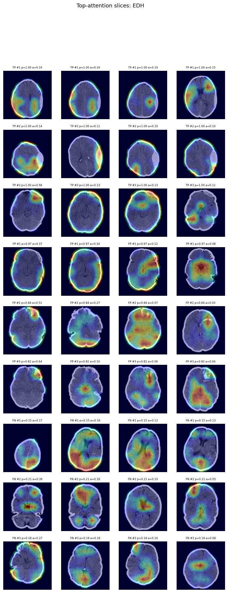 | 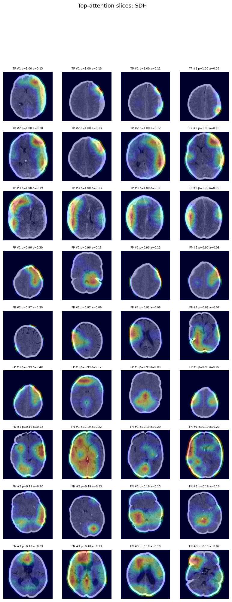 | 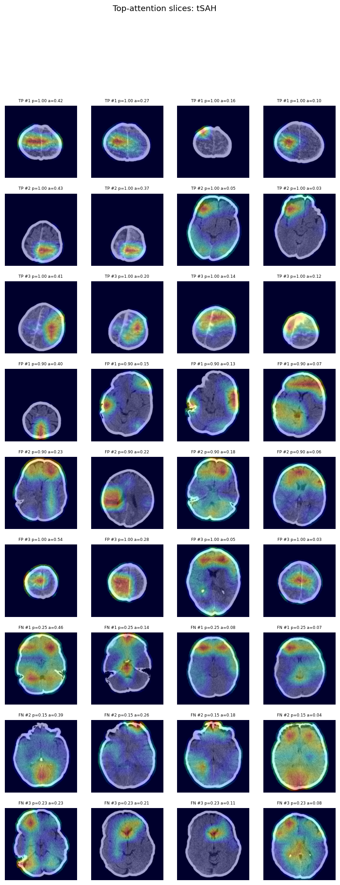 | 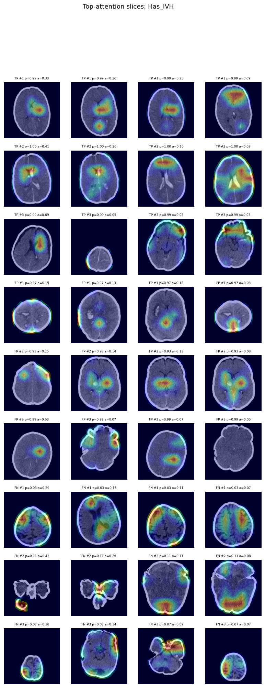 | 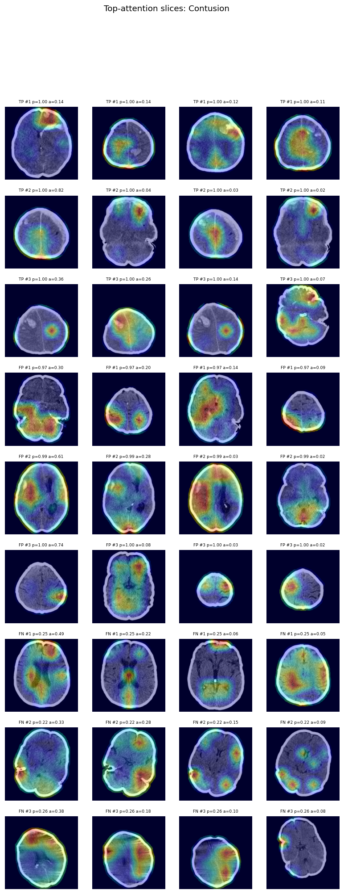 |

`e2e_vh` (original bags; note skull-base / orbit slices and background Grad-CAM):

| EDH | SDH | tSAH | IVH | Contusion |
|---|---|---|---|---|
| 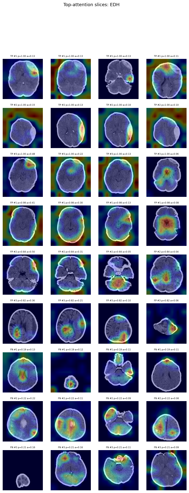 | 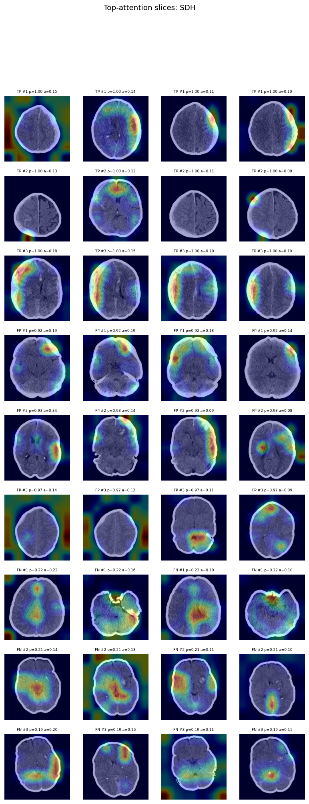 | 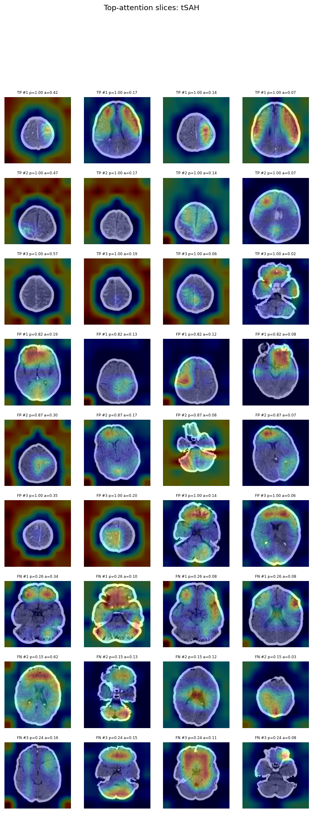 | 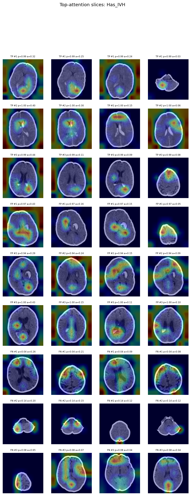 | 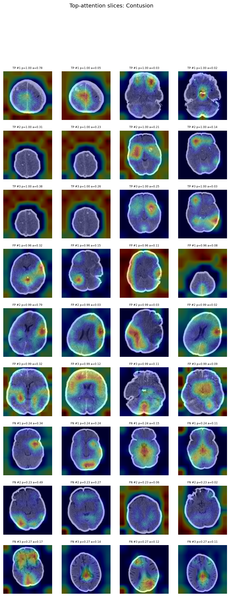 |

**Main model (Stage B), test set**

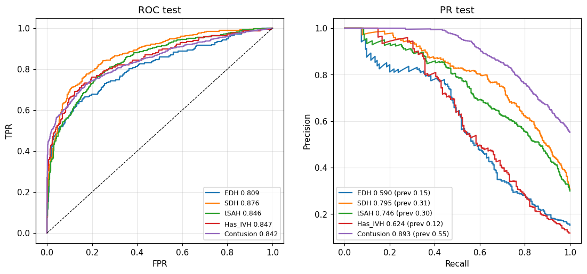
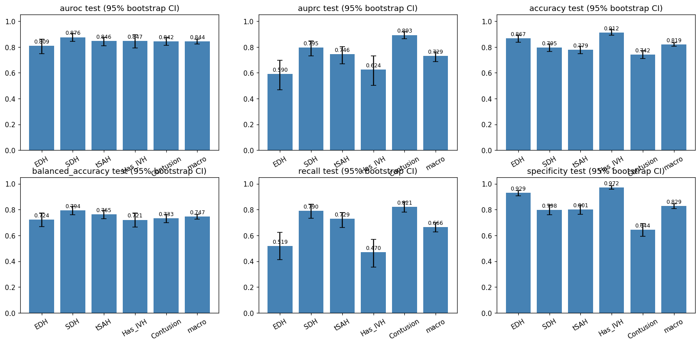
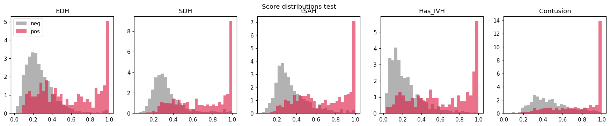
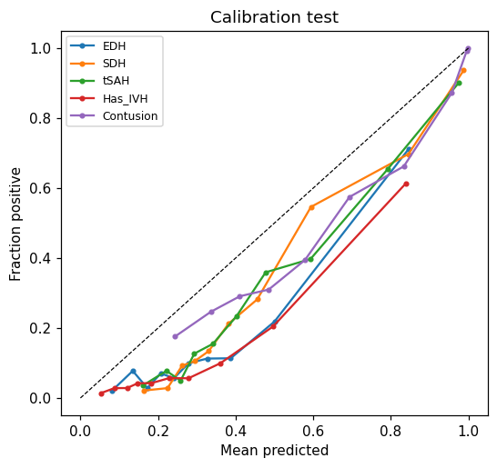
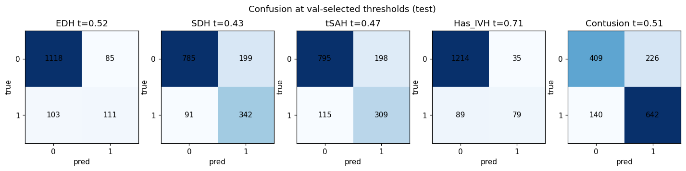

Operating point at 80 % recall (thresholds from val): `docs/figures/eval/e2e_vh_recall80/`.
Stage A on the same plots: `docs/figures/eval/abmil_vh/`. Continued run on re-trimmed bags:
`docs/figures/eval/e2e_vh_ft/`, `docs/figures/eval/e2e_vh_ft_recall80/`,
`docs/figures/train/e2e_vh_ft_training_curves.png`.

**Training curves**

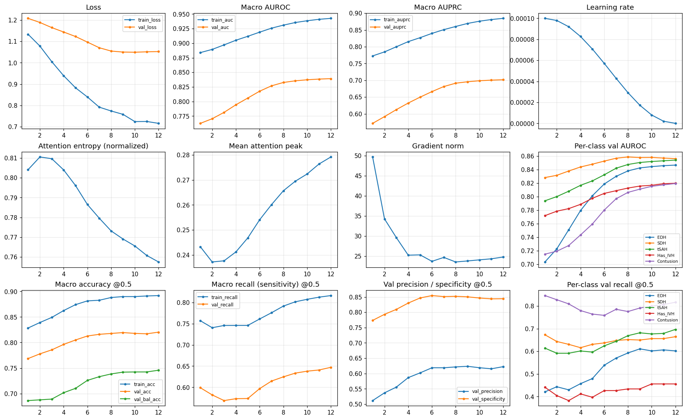
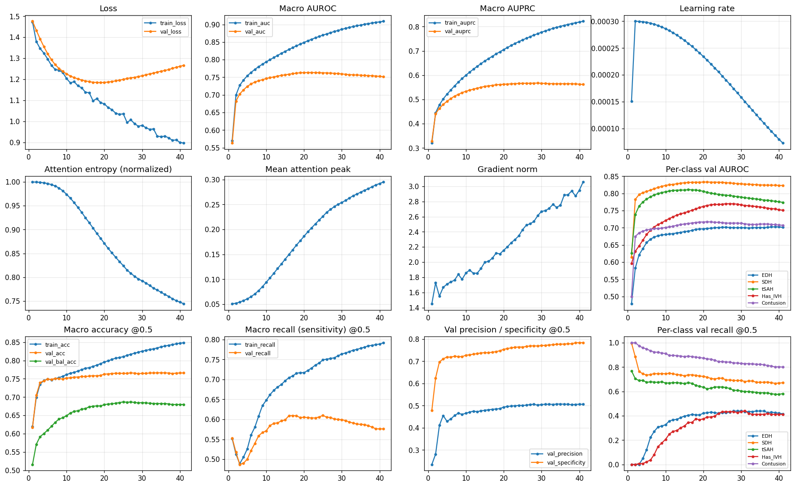

Ablation runs: `docs/figures/train/abl_*_training_curves.png`.

**Dataset and leakage audit**

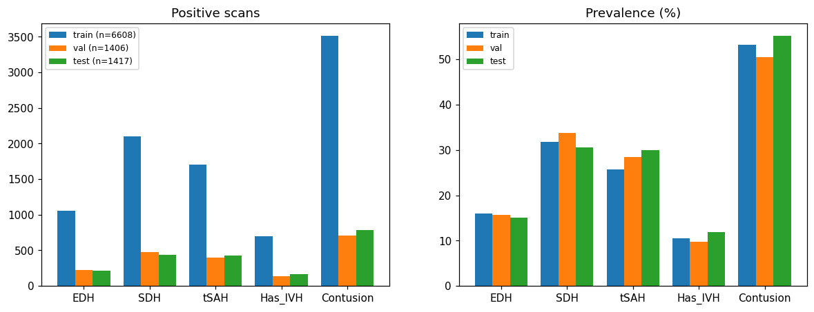
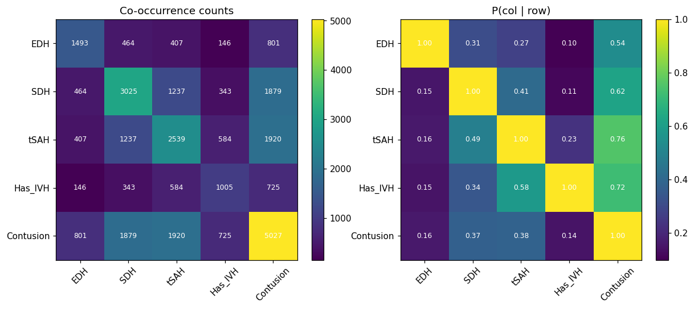
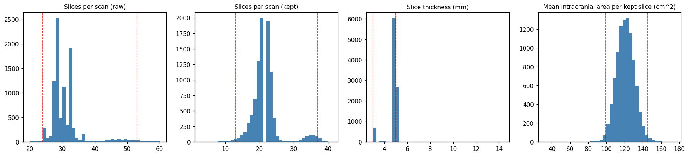
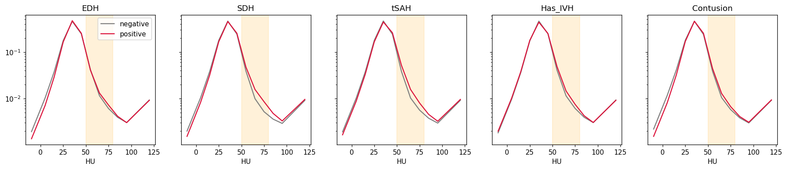
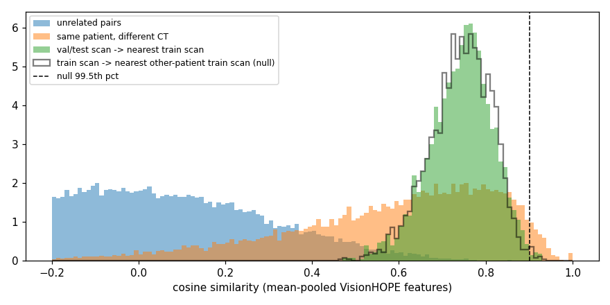

## Limitations

- Single institution, single scanner protocol family (mostly 4.8-5 mm slices); no external validation.
- Labels are radiologist reports at scan level; slice locations are unknown, so attention maps are weak
  localization evidence only.
- Rare classes (EDH, IVH) have wide confidence intervals and low precision at high-recall operating points.
- Not a medical device and not clinically validated.
